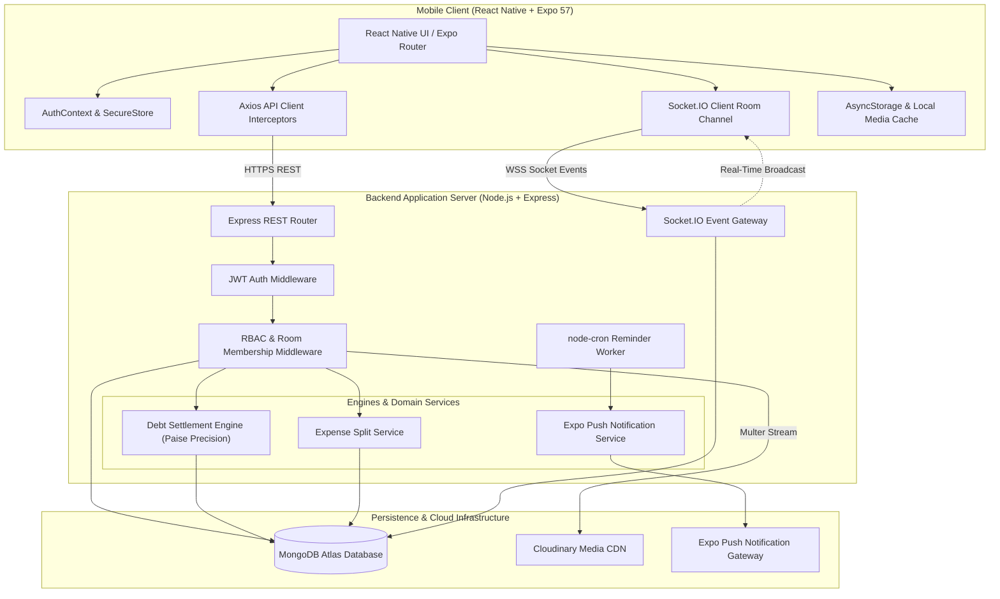
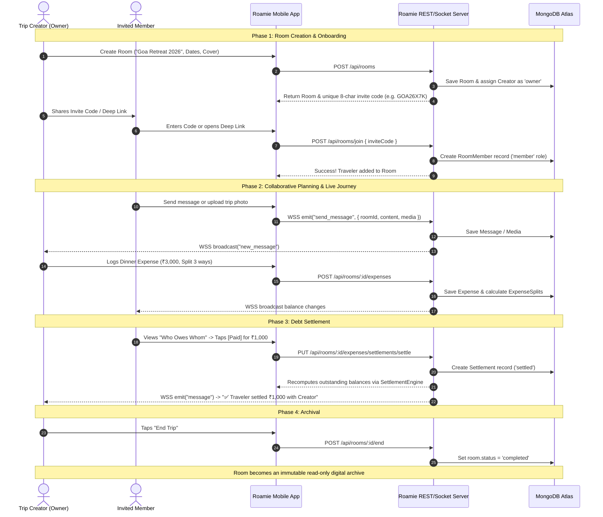
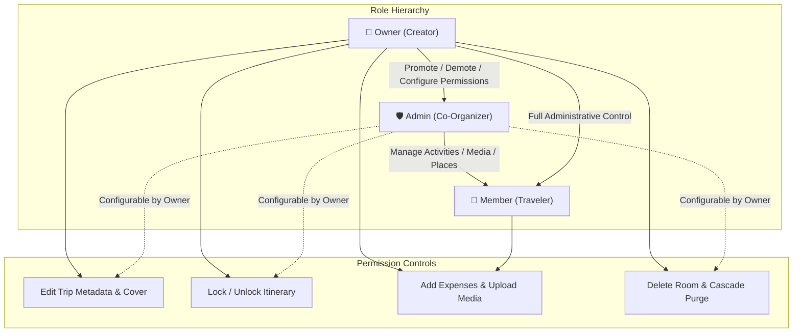
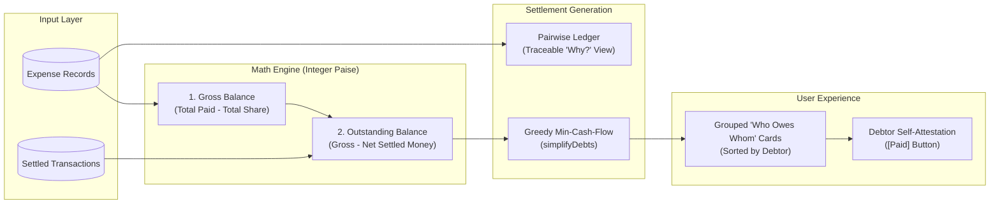
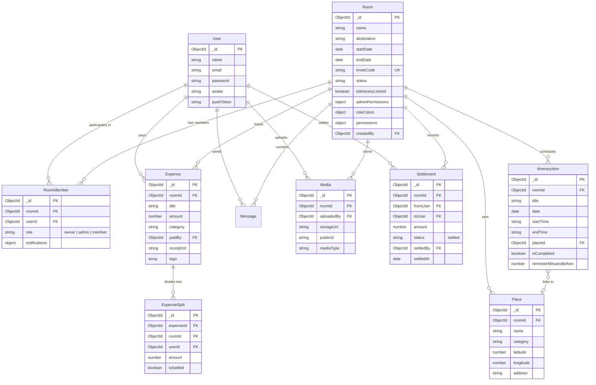
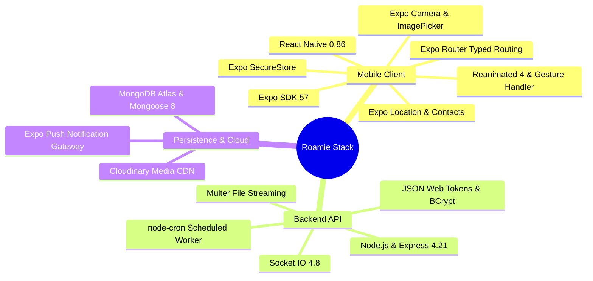

# 🗺️ Roamie — Private Collaborative Travel Companion

[](https://nodejs.org/)
[](https://reactnative.dev/)
[](https://expo.dev/)
[](https://www.typescriptlang.org/)
[](https://www.mongodb.com/)
[](https://socket.io/)
[](https://cloudinary.com/)
[](LICENSE)

> **One private, collaborative space where everything about a journey lives.**  
> No more juggling WhatsApp for chatter, Splitwise for bills, Google Photos for memories, and Notes/Calendar for itineraries. Roamie centralizes your entire trip lifecycle into an intuitive, real-time shared workspace.

---

## 📖 Table of Contents

- [The Problem \& The Roamie Solution](#-the-problem--the-roamie-solution)
- [System Architecture](#-system-architecture)
- [End-to-End User Workflow](#-end-to-end-user-workflow)
- [Core Functional Modules](#-core-functional-modules)
  - [1. The Room Domain \& RBAC Engine](#1-the-room-domain--rbac-engine)
  - [2. Algorithmic Debt Management \& Settlement Engine](#2-algorithmic-debt-management--settlement-engine)
  - [3. Real-Time Communication Hub (Chat)](#3-real-time-communication-hub-chat)
  - [4. Shared Media Cloud \& Offline-First Sync](#4-shared-media-cloud--offline-first-sync)
  - [5. Chronological Itinerary \& Geocoded Places](#5-chronological-itinerary--geocoded-places)
  - [6. Room Dashboard \& Live Analytics](#6-room-dashboard--live-analytics)
- [Database Schema \& Data Models](#-database-schema--data-models)
- [API Architecture \& Endpoint Catalogue](#-api-architecture--endpoint-catalogue)
- [Technology Stack](#-technology-stack)
- [Project Directory Structure](#-project-directory-structure)
- [Installation \& Local Setup](#-installation--local-setup)
- [Testing \& Verification](#-testing--verification)
- [Design Philosophy \& Aesthetics](#-design-philosophy--aesthetics)
- [Authors \& Acknowledgements](#-authors--acknowledgements)

---

## 💡 The Problem & The Roamie Solution

### The Friction in Modern Travel
When groups or solo adventurers travel today, their critical trip data is scattered across incompatible apps:
- **Chatter & Plans:** Buried in WhatsApp/Telegram group chats.
- **Photos & Videos:** Dumped in Google Photos or Apple Shared Albums weeks late.
- **Finances:** Managed in Splitwise where debts can get confusing or desynchronized.
- **Schedules:** Fragmented across Apple Notes, Google Calendar, or screenshots.
- **Places & POIs:** Bookmarked across Google Maps, Instagram saves, and TripAdvisor.

When the trip ends, memories get lost in endless scrollback, unsettled debts turn awkward, and photos remain trapped on individual phones.

### The Roamie Paradigm
Roamie introduces the **"Room"** (a dedicated journey session). Every resource—chat messages, receipts, itinerary items, pinned GPS coordinates, and media—is strictly bound to that specific Room:
- **Solo or Group:** Start a solo itinerary anytime; invite travelers via link, code, or phone contacts when needed.
- **Strict Authorization Boundary:** Every backend request verifies: *"Does this user belong to this Room with appropriate role privileges?"*
- **Persistent Archive:** Once a trip is marked `completed`, nothing is purged. The Room transforms into an interactive, read-only digital time capsule.

---

## 🏗️ System Architecture

Roamie is engineered with a decoupled client-server architecture combining **RESTful micro-endpoints** for CRUD operations and **bi-directional Socket.IO channels** for live collaborative state synchronization.



---

## 🔄 End-to-End User Workflow

The journey progresses across four defined states in the Room lifecycle:



---

## 🧩 Core Functional Modules

### 1. The Room Domain & RBAC Engine
The Room is the central container of Roamie. All entities maintain a direct reference to `roomId`. Roamie implements a multi-tier **Role-Based Access Control (RBAC)** architecture:



#### RBAC Permissions Matrix

| Capability | Member (Default) | Admin | Owner | Configurable in Settings? |
|:---|:---:|:---:|:---:|:---:|
| **Group Chat & Emoji Reactions** | ✅ | ✅ | ✅ | Always Enabled |
| **Upload Photos to Shared Gallery** | ✅ | ✅ | ✅ | Yes (Owner toggle) |
| **Add / Edit Itinerary Items** | ✅ | ✅ | ✅ | Yes (Owner toggle) |
| **Log Trip Expenses & Splits** | ✅ | ✅ | ✅ | Yes (Owner toggle) |
| **Save & Geocode Places** | ✅ | ✅ | ✅ | Yes (Owner toggle) |
| **Invite Friends (Code / Link)** | ✅ | ✅ | ✅ | Yes (Owner toggle) |
| **Edit Trip Details & Cover** | ❌ | ✅ | ✅ | Yes (Admin toggle) |
| **Lock / Finalize Itinerary** | ❌ | ✅ | ✅ | Yes (Admin toggle) |
| **End / Complete Trip (Archive)** | ❌ | ✅ | ✅ | Yes (Admin toggle) |
| **Manage Roles (Promote/Demote)** | ❌ | Optional | ✅ | Yes (Admin toggle) |
| **Delete Room & Cascade Data** | ❌ | Optional | ✅ | Owner Only |

---

### 2. Algorithmic Debt Management & Settlement Engine

Roamie features a custom-built financial engine ([`settlementEngine.js`](file:///c:/Users/HP/OneDrive/Desktop/Roamie/settlementEngine.js)) designed to eliminate the common accounting bugs that plague shared trip apps.



#### 🔑 Key Engine Guarantees:
1. **Gross vs. Outstanding Balance Separation**:
   - **Gross Balance**: $\text{totalPaid} - \text{totalShare}$. Immutable reflection of expense history.
   - **Outstanding Balance**: $\text{grossBalance} - (\text{net settled reimbursements})$.
   - *Why this matters*: Generating settlements from gross balances causes already-paid debts to reappear whenever new expenses are added. Roamie always generates pending settlements strictly from **outstanding balances**.
2. **Integer Paise Arithmetic**:
   - All internal calculations are computed in integer paise ($1\text{ INR} = 100\text{ paise}$) to avoid IEEE-754 floating-point rounding errors across split distributions.
3. **Greedy Min-Cash-Flow Debt Simplification (`simplifyDebts`)**:
   - Groups debtors and creditors into sorted queues and iteratively pairs the largest debtor with the largest creditor, minimizing the total number of inter-member transactions across the entire group.
4. **Traceable Pairwise Ledger (`calculatePairwiseDebts`)**:
   - Maintains an exact, unsimplified transaction path for the **"Why?"** audit modal. If an edge was produced through multi-hop simplification without direct shared spending, Roamie flags `isExact: false` and honestly communicates that the edge resolves aggregate group balance.
5. **Debtor-Only Self-Attestation with Admin Override**:
   - Only the debtor (`fromUser`) can mark an edge as `[Paid]`. Creditors cannot unilaterally cancel debts. Owners and Admins hold override power for in-person cash reconciliations.

---

### 3. Real-Time Communication Hub (Chat)
The Chat tab acts as the primary live communication channel for travelers:
- **Discord-Inspired Travel Journal Design**: Rendered on a warm parchment canvas (`#FAF7F2`) with topographic contour lines and dynamic role-colored author badges.
- **WebSocket Room Channels**: Scoped strictly to `room:<roomId>`.
- **Micro-Interactions**:
  - **Swipe-to-Reply**: Pan gesture with haptic feedback and inline quoted previews.
  - **Long-Press Action Sheet**: 5 quick emoji reactions, full emoji picker, copy, pin/unpin, and delete.
  - **Pinned Messages Banner**: Header bar cycling active pins with auto-scroll jumping.
  - **Live Typing & Read Status**: Dynamic typing indicators broadcast across the room.

---

### 4. Shared Media Cloud & Offline-First Sync
- **Collision-Proof Media Storage**: Files are renamed with unique UUID keys and stored in room-isolated folders on Cloudinary (`roamie/rooms/<roomId>/`).
- **Incremental Synchronization Protocol**:
  - The client queries `GET /api/rooms/:roomId/media?after=<lastSyncedAt>` to fetch only incremental uploads.
  - Media metadata is cached locally on the mobile device for offline instant rendering.

---

### 5. Chronological Itinerary & Geocoded Places
- **Day-by-Day Activity Scheduling**: Organizes activities chronologically by calendar date and start/end time.
- **Lock Itinerary Mode**: The Room Owner can lock the itinerary once finalized to prevent accidental overwrites by group members.
- **Geocoded Saved Places**: Members can pin places with GPS coordinates (latitude/longitude), categories (sightseeing, food, stay, nightlife), and compute live distance metrics from their current device position.
- **Automated Push Reminder Worker**: A background `node-cron` worker queries upcoming itinerary items every minute and dispatches Expo push alerts to travelers before scheduled activities.

---

### 6. Room Dashboard & Live Analytics
The **About** tab provides dynamic overview metrics:
- **Live Trip Progress Bar**: e.g., *"Day 2 of 5 — 40% Completed"*.
- **Financial & Social Telemetry**: Real-time counters showing total group expenditure, photos shared, places saved, and active message volume.
- **Member Directory**: Visual list of travelers with custom role badges and contact information.

---

## 🗄️ Database Schema & Data Models



---

## 📡 API Architecture & Endpoint Catalogue

All endpoints (except public auth) require a Bearer JWT passed in the `Authorization` header:

### 🔐 Authentication (`/api/auth`)
| Method | Endpoint | Description | Access |
|---|---|---|---|
| `POST` | `/api/auth/register` | Register a new user account | Public |
| `POST` | `/api/auth/login` | Authenticate user and issue JWT | Public |
| `GET` | `/api/auth/me` | Fetch authenticated user profile | Private |
| `PUT` | `/api/auth/profile` | Update profile data & push tokens | Private |

### 🏕️ Rooms & Membership (`/api/rooms`)
| Method | Endpoint | Description | Access |
|---|---|---|---|
| `POST` | `/api/rooms` | Create a new Room session | Private |
| `GET` | `/api/rooms` | List user's rooms (Active, Planning, Completed) | Private |
| `GET` | `/api/rooms/:id` | Fetch complete room details & analytics | Room Member |
| `PUT` | `/api/rooms/:id` | Update trip info & cover photo | Owner / Admin |
| `DELETE` | `/api/rooms/:id` | Cascade delete room & related data | Owner Only |
| `GET` | `/api/rooms/invite/:inviteCode` | Preview room metadata before joining | Private |
| `POST` | `/api/rooms/join` | Join a room using 8-character invite code | Private |
| `POST` | `/api/rooms/:id/invite` | Invite contacts via SMS / deep link | Room Member |
| `POST` | `/api/rooms/:id/leave` | Voluntarily exit a room | Room Member |
| `POST` | `/api/rooms/:id/end` | Transition room state to `completed` | Owner / Admin |
| `POST` | `/api/rooms/:id/itinerary/lock` | Toggle itinerary lock status | Owner / Admin |
| `PATCH`| `/api/rooms/:id/admin-permissions`| Update custom admin permission flags | Owner Only |
| `PUT` | `/api/rooms/:id/role-colors` | Customize badge colors for roles | Owner Only |
| `PUT` | `/api/rooms/:id/members/:memberId/role` | Promote/demote members | Owner Only |

### 💬 Real-Time Chat (`/api/rooms/:roomId/messages`)
| Method | Endpoint | Description | Access |
|---|---|---|---|
| `GET` | `/` | Paginated message scrollback history | Room Member |
| `POST` | `/` | Send a new text/media message | Room Member |
| `POST` | `/:messageId/reactions` | Toggle emoji reaction on message | Room Member |
| `POST` | `/:messageId/pin` | Pin or unpin a message | Room Member |
| `DELETE` | `/:messageId` | Delete a message (Author, Admin, Owner) | Authorized |

### 💰 Expenses & Debt Settlement (`/api/rooms/:roomId/expenses`)
| Method | Endpoint | Description | Access |
|---|---|---|---|
| `POST` | `/` | Create expense with custom member splits | Room Member |
| `GET` | `/` | List all room expenses and attached receipts | Room Member |
| `GET` | `/balances` | Fetch net balances & simplified settlements | Room Member |
| `PUT` | `/settlements/settle` | Settle an outstanding debt edge | Debtor / Admin |
| `DELETE` | `/:expenseId` | Delete expense and recompute balances | Payer / Owner |

### 📸 Media & Gallery (`/api/rooms/:roomId/media`)
| Method | Endpoint | Description | Access |
|---|---|---|---|
| `POST` | `/` | Upload photos/receipts to Cloudinary | Room Member |
| `GET` | `/?after=<timestamp>` | Incremental gallery sync | Room Member |
| `DELETE` | `/:mediaId` | Delete photo from room gallery | Uploader / Owner |

### 🗓️ Itinerary & Places (`/api/rooms/:roomId/itinerary` & `places`)
| Method | Endpoint | Description | Access |
|---|---|---|---|
| `GET` | `/itinerary` | Fetch activities grouped by calendar day | Room Member |
| `POST` | `/itinerary` | Schedule a new activity | Room Member |
| `PUT` | `/itinerary/:id` | Update activity or toggle completion | Room Member |
| `DELETE`| `/itinerary/:id` | Remove activity from schedule | Room Member |
| `GET` | `/places` | List all pinned geographic locations | Room Member |
| `POST` | `/places` | Save place with GPS coordinates | Room Member |

---

## 💻 Technology Stack



---

## 📂 Project Directory Structure

```plaintext
Roamie/
├── client/                          # React Native / Expo Mobile Application
│   ├── assets/                      # App icons, splash screens, and raster imagery
│   ├── src/
│   │   ├── app/                     # Expo Router file-based route definitions
│   │   │   ├── _layout.tsx          # Root navigation provider, fonts & auth hydration
│   │   │   ├── index.tsx            # Welcome landing screen & auth modal orchestrator
│   │   │   ├── rooms.tsx            # Main Home screen (Active / Planning / Archive)
│   │   │   ├── create-room.tsx      # Multi-step room creation workflow
│   │   │   └── room/
│   │   │       └── [id].tsx         # Dynamic room root & 5-tab shell container
│   │   ├── components/
│   │   │   ├── auth/                # Login, registration, and credential forms
│   │   │   ├── room/                # Room UI components & tab implementations
│   │   │   │   ├── chat/            # Chat bubbles, swipe-to-reply, emoji action sheet
│   │   │   │   ├── expenses/        # AddExpense modal, split selectors, Who Owes Whom
│   │   │   │   ├── AboutTab.tsx     # Room statistics, member roster, and settings
│   │   │   │   ├── ExpensesTab.tsx  # Net balance cards & transaction feeds
│   │   │   │   └── RoomBottomNav.tsx# Elevated center 5-tab navigation bar
│   │   │   └── AppAlertHost.tsx     # Themed confirmation and alert modals
│   │   ├── constants/               # Design tokens, parchment palettes, typography
│   │   ├── context/                 # AuthContext (JWT management & session state)
│   │   ├── services/                # Axios API client & Socket.IO client connections
│   │   └── types/                   # TypeScript interfaces and domain definitions
│   ├── app.json                     # Expo manifest configuration
│   └── package.json                 # Client dependencies and scripts
│
├── server/                          # Node.js / Express Backend & WebSocket Server
│   ├── src/
│   │   ├── config/                  # MongoDB Mongoose database connection
│   │   ├── controllers/             # Request handlers for Auth, Rooms, Expenses, etc.
│   │   ├── middlewares/             # JWT verification & RBAC authorization logic
│   │   ├── models/                  # Mongoose domain models (Room, Expense, User, etc.)
│   │   ├── routes/                  # Express REST route definitions
│   │   ├── services/                # Debt engine, push notifications, and cron workers
│   │   ├── sockets/                 # Socket.IO event handlers and channel routers
│   │   ├── app.js                   # Express application middleware pipeline
│   │   └── server.js                # HTTP server bootstrap & socket initialization
│   ├── tests/                       # Comprehensive integration test suites
│   ├── uploads/                     # Local temporary upload cache
│   └── package.json                 # Server dependencies and scripts
│
├── settlementEngine.js              # Pure-function mathematical debt simplification engine
├── prd.md                           # Product Requirements Document
├── tasks.md                         # Phased development roadmap and verification status
└── README.md                        # Master repository documentation
```

---

## 🚀 Installation & Local Setup

### Prerequisites
- [Node.js](https://nodejs.org/) (v18.x or higher)
- [MongoDB](https://www.mongodb.com/) (Local instance or MongoDB Atlas URI)
- [Expo Go](https://expo.dev/go) on iOS/Android or an active Android Studio/Xcode Simulator
- [Cloudinary](https://cloudinary.com/) Account (for cloud media storage)

---

### 1. Backend Setup

1. **Navigate to the server directory:**
   ```bash
   cd server
   ```

2. **Install dependencies:**
   ```bash
   npm install
   ```

3. **Configure Environment Variables:**
   Create a `.env` file in `server/` using the template below:
   ```env
   PORT=5000
   NODE_ENV=development
   MONGODB_URI=mongodb://localhost:27017/roamie
   JWT_SECRET=your_super_secret_jwt_key_2026
   JWT_EXPIRE=30d

   # Cloudinary Media Configuration
   CLOUDINARY_CLOUD_NAME=your_cloud_name
   CLOUDINARY_API_KEY=your_api_key
   CLOUDINARY_API_SECRET=your_api_secret

   # Mobile Client Deep Linking
   CLIENT_URL=exp://localhost:8081
   ```

4. **Start the development server:**
   ```bash
   npm run dev
   ```
   *The backend will boot on `http://localhost:5000` with the itinerary reminder cron initialized.*

---

### 2. Mobile Client Setup

1. **Navigate to the client directory:**
   ```bash
   cd client
   ```

2. **Install dependencies:**
   ```bash
   npm install
   ```

3. **Configure Environment Variables:**
   Create a `.env` file in `client/`:
   ```env
   # Set to your machine's LAN IP for physical device testing, or localhost for emulators
   EXPO_PUBLIC_API_URL=http://localhost:5000/api
   ```

4. **Launch the Expo development server:**
   ```bash
   npx expo start
   ```

5. **Run the application:**
   - Press `a` to open in Android Emulator.
   - Press `i` to open in iOS Simulator.
   - Press `w` to open in Web Browser.
   - Scan the terminal QR code with the **Expo Go** mobile app.

---

## 🧪 Testing & Verification

Roamie includes automated test suites validating authentication, room management, debt simplification algorithms, and role boundaries:

```bash
# Run server test suites from the server directory
cd server

# Test Authentication & JWT Lifecycle
node tests/auth.test.js

# Test Room Lifecycle & Authorization
node tests/room.test.js

# Test Roles & Granular RBAC Permissions
node tests/roles-permissions.test.js

# Test Expense Splitting & Debt Simplification
node tests/expense.test.js

# Test Real-Time Chat & Socket Handlers
node tests/chat.test.js

# Test Itinerary & Geocoded Places
node tests/itinerary-places.test.js

# Test Media Storage & Cloudinary Uploads
node tests/media.test.js
```

---

## 🎨 Design Philosophy & Aesthetics

Roamie rejects generic cold corporate styling in favor of an **Emergent Travel Journal Aesthetic**:

| Design Token | Color Code | Role & Psychological Tone |
|---|:---:|---|
| **Warm Parchment** | `#F4EBDD` | Primary canvas, reminiscent of topographic paper maps. |
| **Deep Forest Green** | `#243C32` | Primary typography and structural headers. |
| **Burnt Terracotta** | `#C96A25` | Primary action accent, warm sunrise highlights. |
| **Amber Orange** | `#E18A3A` | Secondary badge highlights and active tabs. |
| **Card Cream** | `#F8F1E5` | Elevation card containers and message bubbles. |
| **Topographic Contours** | `#EADBCB` | Watermark lines and dividers. |

- **Zero Standard Browser Alerts**: Replaced with tactile, custom-themed dialog modals ([`AppAlertHost.tsx`](file:///c:/Users/HP/OneDrive/Desktop/Roamie/client/src/components/AppAlertHost.tsx)).
- **Tactile Haptic Feedback**: Integrated across swipe gestures, message reactions, and debt clearance actions.

---

## 👥 Authors & Acknowledgements

- **Daksh** ([@daksh006v](https://github.com/daksh006v)) — *Architecture, Backend Engineering, Settlement Engine & Mobile Client*

---

<div align="center">
  <sub>Built with ❤️ for wanderers, adventurers, and memory keepers worldwide.</sub><br>
  <sub>Roamie &copy; 2026. All rights reserved.</sub>
</div>
